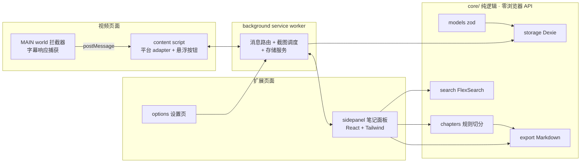

# 学知云课记

> 跨浏览器网课学习笔记扩展：一键截图、时间戳回跳、字幕全文检索、离线语音转写、Markdown 导出。
> 免登录、免配置、数据全部本地存储、永久免费、开源（MIT）。

界面语言默认跟随系统（中文环境显示中文，其他环境显示英文 / XZY Notes），可在设置页手动指定「跟随系统 / 中文 / English」。

了解更多课程内容与 AI 学习工具，请访问 [学知云官网](https://www.xzynet.com)。

<!-- 功能截图占位 -->

<!--  -->

## 功能

- **一键截图笔记**：`Alt+S` 抓取当前视频帧（1280px JPEG），自动记录时间戳，视频不暂停；`Alt+A` 截图后进入圈画标注器（矩形/箭头/画笔/文字/马赛克）
- **时间戳回跳**：点击笔记时间戳跳回对应时刻；支持 A-B 区间循环复读
- **字幕时间轴**：完整字幕全文展示、FlexSearch 全文检索（中文分词优化）、跟随播放高亮、点击跳转
- **本地语音转写（无字幕兜底）**：视频无字幕时一键用本地 sherpa-onnx WASM 模型转写：解析到视频源文件时整段/流式快进转写（远快于实时，Chrome / Firefox 均可用）；Chrome 在拿不到直链时还可捕获标签页音频跟随播放实时转写（双模型：Paraformer 流式 / SenseVoice，Firefox 为 Paraformer）。Chrome 上模型下载与转写都在独立文档里跑，**关掉侧栏也会继续**（下载支持断点续传），重开面板自动接回进度；后台跑完时扩展图标会打勾提示。模型首次下载后离线可用，转写结果可检索/回跳/生成章节并持久化
- **章节大纲**：规则版切分（字幕停顿 + 话题转换词 + 弹幕密度微调），折叠可选
- **Markdown 导出**：章节大纲目录 + 按时间排列的笔记 + 截图（base64 内嵌或文件引用）+ 时间戳回跳链接，兼容 Obsidian / Notion
- **本地存储**：IndexedDB（Dexie），设置页可看占用、全量备份/恢复（zip）

### 支持平台

| 平台 | 状态 |
| --- | --- |
| B站（bilibili.com） | ✅ 支持视频页（CC 字幕、弹幕密度、时间戳回跳） |
| 中国大学MOOC（icourse163.org） | ✅ 支持（页面提供的 AI 字幕与 SRT 字幕时间轴，兼容 UTF-16） |
| 学堂在线（xuetangx.com） | ⚠️ 已适配，待回归验证（字幕时间轴与检索） |
| 智慧树（zhihuishu.com） | ⚠️ 已适配，待回归验证（不注入 MAIN world、不 hook 页面 `fetch`/XHR、不挂悬浮按钮；字幕经 textTrack/资源扫描读取） |
| YouTube（youtube.com） | ✅ 支持 watch 页（CC 字幕、时间戳回跳） |
| 一般 HTML5 `<video>` 页面 | ✅ 通用模式（点击工具栏图标按需激活；支持截图、笔记、回跳及可用的本地转写，实际能力取决于页面与媒体格式；MSE/HLS 页面在 Chrome 可使用实时音频转写，Firefox 不支持标签页音频捕获） |

> 功能可用性取决于页面实际提供的字幕、媒体格式及平台当前版本；平台改版可能影响兼容性。

## 安装

### Chrome / Edge

pnpm install 安装依赖

1. 下载或构建产物：`pnpm build` → `.output/chrome-mv3/`
2. 打开 `chrome://extensions` → 开启「开发者模式」→「加载已解压的扩展程序」→ 选择 `.output/chrome-mv3`

### Firefox

`pnpm build:firefox` → `.output/firefox-mv3/`；`about:debugging` →「临时载入附加组件」→ 选择其中的 `manifest.json`。

### 国产浏览器手动侧载

360 极速、QQ 浏览器、搜狗高速浏览器等 Chromium 内核浏览器均支持手动侧载：
打开「扩展管理」页（通常为 `chrome://extensions` 或浏览器菜单 → 工具 → 扩展），开启「开发者模式」，将 `.output/chrome-mv3` 文件夹拖入页面即可。

## 使用

在支持的平台打开视频页，点击工具栏图标或页面右下角「学知云课记」悬浮按钮打开侧栏。一般 HTML5 视频页也可使用通用模式：点击工具栏图标完成激活（同时授权页面脚本注入与语音转写捕获），面板自动进入通用模式。

| 快捷键     | 功能           |
| ------- | ------------ |
| `Alt+S` | 截图笔记         |
| `Alt+A` | 截图并圈画标注      |
| `Alt+N` | 在当前时间点新建文字笔记 |
| `Alt+K` | 打开面板         |
| `Alt+B` | 收藏当前时间点      |

快捷键可在 `chrome://extensions/shortcuts` 自定义（Chrome 不允许扩展内编程修改）。

## 使用边界

本项目仅限用于用户有权访问的课程和个人学习。不得用于绕过登录、付费、DRM 等访问或版权保护措施，不得用于考试作弊或批量抓取。

导出或分享笔记、截图、字幕及转写内容时，请遵守适用的平台协议与法律，并尊重内容权利人的权益。本项目不授予用户对课程内容或平台接口的任何额外权利。

## 开发

```bash
pnpm install          # 安装依赖
pnpm dev              # Chrome 开发模式（热更新）
pnpm dev:firefox      # Firefox 开发模式
pnpm test             # 单元测试（vitest，core/ 覆盖率门槛 80%）
pnpm test:coverage    # 带覆盖率门槛的测试
pnpm test:e2e         # Playwright E2E（需先 pnpm build）
pnpm lint             # ESLint
pnpm compile          # TypeScript strict 检查
pnpm build            # Chrome MV3 构建 → .output/chrome-mv3
pnpm build:firefox    # Firefox MV3 构建 → .output/firefox-mv3
pnpm zip              # Chrome 发布包 → .output/kedaibiao-1.0.0-chrome.zip
pnpm zip:firefox      # Firefox 发布包 + AMO 源码包 → .output/kedaibiao-1.0.0-{firefox,sources}.zip
```

### 打包（zip）

`wxt zip` 自带一次生产构建，无需先跑 `pnpm build`；产物落在 `.output/`，只包含 `.output/<browser>-mv3/` 里的构建产物：

| 命令             | 产物                                     | 用途                     |
| -------------- | -------------------------------------- | ---------------------- |
| `pnpm zip`     | `kedaibiao-1.0.0-chrome.zip`           | 上传 Chrome Web Store    |
| `pnpm zip:firefox` | `kedaibiao-1.0.0-firefox.zip`          | 提交 AMO（Firefox 附加组件）    |
| `pnpm zip:firefox` | `kedaibiao-1.0.0-sources.zip`          | AMO 审查要求的源码包           |

- 文件名模板为 `{{name}}-{{packageVersion}}-{{browser}}.zip`：`name` 取 `package.json` 的 `name`（`kedaibiao`），版本取 `version`，因此改版本号后文件名自动跟着变。
- 源码包对 `firefox` 目标默认产出（WXT 的 `zipSources` 在目标为 firefox / opera 时自动开启），也可用 `pnpm zip --sources` 让 Chrome 一并产出；排除项配在 [wxt.config.ts](wxt.config.ts) 的 `zip.excludeSources`（coverage 报告、kimi 会话导出）。
- 自签 `.crx` 不在这两个脚本里，需要用 Chrome 的 `--pack-extension` 单独打包（见下）；重复打包时带上之前生成的 `.pem`，否则扩展 ID 会变。

### 打包 crx（本地自签）

crx 由 Chrome 自己打包（内置的 `--pack-extension`），所以要先有构建产物：

```bash
pnpm build                     # → .output/chrome-mv3（刚跑过 pnpm zip 则可跳过）

# Windows
& "$env:ProgramFiles\Google\Chrome\Application\chrome.exe" --pack-extension="E:\crius\wmkedaibiao\.output\chrome-mv3"

# macOS
"/Applications/Google Chrome.app/Contents/MacOS/Google Chrome" --pack-extension="$PWD/.output/chrome-mv3"

# Linux
google-chrome --pack-extension="$PWD/.output/chrome-mv3"
```

产物与目录同级：`.output/chrome-mv3.crx`（CRX3）+ `.output/chrome-mv3.pem`（私钥）。

- **扩展 ID 由 `.pem` 里的公钥决定**，与目录名、manifest 的 `name` 都无关。首次生成的 `.pem` 必须留存，之后重打包要显式指定，否则 ID 变化 —— 浏览器会当成另一个扩展，已安装用户和商店条目都对不上：

```bash
& "$env:ProgramFiles\Google\Chrome\Application\chrome.exe" --pack-extension="E:\crius\wmkedaibiao\.output\chrome-mv3" --pack-extension-key="E:\crius\wmkedaibiao\.output\chrome-mv3.pem"
```

- `.pem` 是私钥，绝不能提交到仓库（`.output` 已在 [.gitignore](.gitignore) 中忽略）；换机器发布时私下传递，丢了就只能换 ID。
- crx 适合自签分发/内网部署：双击安装会被 Chrome 以「非商店来源」拦下，仍要走 `chrome://extensions` 开发者模式「加载已解压的扩展程序」选 `.output/chrome-mv3`，或用企业策略白名单放行；上架 Chrome Web Store 交的仍是 `pnpm zip` 的 zip。

### 架构

国际化（界面文案、新增语言方法）见 [docs/i18n.md](docs/i18n.md)。



**架构铁律**：`core/` 禁止任何 `chrome.*`/`browser.*`/DOM API（有单测扫描守护）；平台差异收敛到 `adapters/platforms/`，浏览器差异收敛到 `adapters/browsers/`；后台按 MV3 service worker 严格模型编写（无状态、消息驱动、监听器顶层同步注册）。

### 目录

```
entrypoints/   # content / background / sidepanel(含 asr/ 转写链路) / options / subtitle-interceptor(MAIN world)
core/          # models · storage · chapters · search · export · asr(转写纯逻辑) · ocr(接口预留) · utils
adapters/      # platforms/（bilibili · icourse163 · xuetangx · zhihuishu · generic）· browsers/
components/    # NoteCard · Annotator · Toaster · theme
public/        # icon · wasm/sherpa(sherpa-onnx WASM 运行时) · asr(pcm-worklet)
scripts/       # fetch-sherpa-wasm.mjs（升级 WASM 运行时）· verify-sherpa-runtime.mjs（真实模型链路验证）
tests/         # unit/（vitest）· e2e/（Playwright）
```

> 语音转写的 WASM 运行时已随仓库提交（`public/wasm/sherpa/`，官方 release 剥离模型预载后的产物，见该目录 README）；
> 升级版本时重跑 `node scripts/fetch-sherpa-wasm.mjs`，再用 `node scripts/verify-sherpa-runtime.mjs` 做真实模型全链路验证。

## Roadmap

- V1.0：B站 / MOOC / 学堂在线 + 截图笔记 + 字幕检索 + Markdown 导出
- V1.1：Firefox 完整适配（sidebarAction）
- V1.5：AI 章节（BYOK）、OCR 截图文字识别（tesseract.js，接口已预留）

不做：账号系统、云同步、任何服务端、任何数据上报（隐私红线：插件零网络遥测）。

## License

MIT © xzy

***

# XZY Notes (English)

> A cross-browser extension for taking notes on online-course videos: one-keyframe screenshots, timestamp jump-back, full-text subtitle search, offline speech transcription, and Markdown export.
> No login, no configuration, all data stays local, free forever, open source (MIT).

The UI language follows the browser/system language by default (Chinese for zh locales, English otherwise) and can be set manually in options (Follow system / 中文 / English); AI chapter generation and Markdown export follow the UI language.

Explore more courses and AI-powered learning tools on the [XZY website](https://www.xzynet.com).

## Features

- **Screenshot notes**: `Alt+S` captures the current video frame with its timestamp without pausing; `Alt+A` opens an annotator (rect/arrow/pen/text/mosaic)
- **Timestamp jump-back**: click a note's timestamp to seek; A-B loop replay supported
- **Subtitle timeline**: full transcript, FlexSearch full-text search (CJK-aware tokenizer), follow-playback highlight, click to seek
- **Local speech transcription (fallback for subtitle-less videos, Chrome only)**: sherpa-onnx WASM models (Paraformer streaming / SenseVoice) run fully in-browser; when a direct media URL is resolvable the whole file is transcribed fast-forward (much faster than realtime), otherwise tab audio is captured live; model downloads once with progress, transcript is searchable/seekable and persisted
- **Chapter outline**: rule-based segmentation (subtitle pauses + topic markers + danmaku density)
- **Markdown export**: outline TOC + timestamped notes + screenshots (base64 or file refs) + jump links, Obsidian/Notion compatible
- **Local storage**: IndexedDB via Dexie; storage stats + full zip backup/restore in options

### Platforms

| Platform | Status |
| --- | --- |
| Bilibili (bilibili.com) | ✅ Supported on video pages (CC subtitles, danmaku density, timestamp jump-back) |
| icourse163 MOOC (icourse163.org) | ✅ Supported (timeline for page-provided AI and SRT subtitles; UTF-16 compatible) |
| XueTangX (xuetangx.com) | ⚠️ Adapted; regression verification pending (subtitle timeline and search) |
| Zhihuishu (zhihuishu.com) | ⚠️ Adapted; regression verification pending (no MAIN-world injection, page `fetch`/XHR hooks, or floating button; subtitles via textTracks and resource discovery) |
| YouTube (youtube.com) | ✅ Supported on watch pages (CC subtitles and timestamp jump-back) |
| Standard HTML5 `<video>` pages | ✅ Generic mode (activated on demand from the toolbar; screenshots, notes, jump-back, and local transcription where available; actual capabilities depend on the page and media format. Chrome supports live audio transcription on MSE/HLS pages; Firefox does not support tab audio capture) |

> Availability depends on the subtitles and media formats provided by the page and the current platform version. Platform updates may affect compatibility.

## Install

`pnpm build` → load `.output/chrome-mv3` at `chrome://extensions` (Developer mode → Load unpacked). Firefox: `pnpm build:firefox` → `about:debugging` → load temporary add-on.

## Acceptable Use

This project is intended only for personal study of courses that users are authorized to access. Do not use it to bypass login, paywall, DRM, or other access or copyright-protection controls; to cheat in assessments; or to scrape content in bulk.

When exporting or sharing notes, screenshots, subtitles, or transcripts, comply with applicable platform terms and laws and respect content rightsholders. This project does not grant users any additional rights to course content or platform APIs.

## Develop

```bash
pnpm install && pnpm dev      # Chrome dev with HMR
pnpm test                     # unit tests (vitest, ≥80% coverage gate on core/)
pnpm test:e2e                 # Playwright E2E (run pnpm build first)
pnpm build                    # Chrome MV3
pnpm build:firefox            # Firefox MV3
pnpm zip                      # Chrome store package → .output/kedaibiao-1.0.0-chrome.zip
pnpm zip:firefox              # Firefox package + AMO sources zip → .output/kedaibiao-1.0.0-{firefox,sources}.zip
```

`wxt zip` runs a production build first and only packs `.output/<browser>-mv3/`; artifact names follow `{{name}}-{{packageVersion}}-{{browser}}.zip` from `package.json`. The sources zip is emitted automatically for the firefox target (AMO requires it) and can also be forced with `pnpm zip --sources`. A self-signed `.crx` is not part of these scripts: pack `.output/chrome-mv3` with Chrome's `--pack-extension` (Windows: `& "$env:ProgramFiles\Google\Chrome\Application\chrome.exe" --pack-extension=...`), which emits `.output/chrome-mv3.crx` + `.output/chrome-mv3.pem`. The `.pem` is the private key that determines the extension ID — keep it out of the repo and pass it via `--pack-extension-key` on every repack, otherwise the ID changes.

Architecture rules: `core/` is pure TypeScript (no browser APIs, enforced by tests); platform differences live in `adapters/platforms/`, browser differences in `adapters/browsers/`; the background is stateless, message-driven, MV3-compliant.

## License

MIT © xzy
